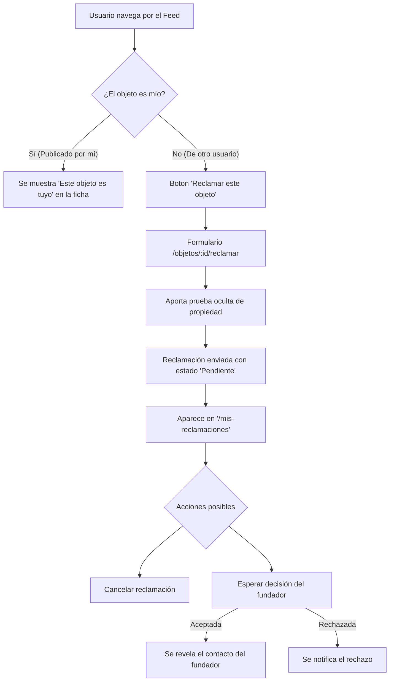

# Feature: Perfil de Usuario y Gestión de Reclamaciones (`features/account`)

> **Área del usuario y ciclo de vida de reclamaciones** en Finder. Permite a los usuarios consultar sus datos, administrar sus objetos publicados, revisar las reclamaciones recibidas de otros usuarios y gestionar sus propias reclamaciones enviadas.

---

## 🚀 Qué se ha desarrollado en esta rama (`feature/perfil-usuario`)

En esta etapa se ha implementado el **flujo completo de usuario autenticado (Lucía Martín)**, integrando la gestión de perfil y el sistema bidireccional de reclamaciones:

1. **Panel Principal de Perfil (`/perfil`)**:
   - Tarjeta personal con avatar, nombre, correo y ciudad (`Lucía Martín — Madrid`).
   - Estadísticas en tiempo real de objetos publicados y reclamaciones activas.
   - Accesos directos a la gestión de objetos propios y reclamaciones.

2. **Mis Objetos Publicados y Reclamaciones Recibidas (`/mis-publicaciones`)**:
   - Pestaña **"Mis publicaciones"**: Listado de los 3 objetos publicados por Lucía (todos localizados en Madrid para dar coherencia y credibilidad).
   - Pestaña **"Reclamaciones recibidas"**: Panel para revisar solicitudes de terceros sobre los objetos propios. Muestra la prueba de propiedad aportada por el solicitante y permite **Aceptar** o **Rechazar** la reclamación. Al aceptar, se desbloquean los datos de contacto directo.

3. **Mis Reclamaciones Enviadas (`/mis-reclamaciones`)**:
   - Listado de reclamaciones realizadas por Lucía sobre objetos encontrados por otros usuarios de la comunidad.
   - Indicador visual de estado (**Pendiente**, **Aceptada**, **Rechazada**).
   - **Botón "Cancelar reclamación"**: Permite al usuario retirar un mensaje de reclamación enviado por error o arrepentimiento.

4. **Formulario de Reclamar Objeto (`/objetos/:id/reclamar`)**:
   - Accesible desde la ficha de cualquier objeto de la comunidad.
   - Formulario validado con `react-hook-form` y `zod` en español.
   - El usuario debe aportar una **prueba de propiedad** (detalles no visibles en la foto o descripción pública, como grabados o contenido del interior).

---

## 📁 Estructura y Componentes de `features/account`

| Archivo / Componente | Descripción y Responsabilidad |
|---|---|
| [`login-page.tsx`](file:///c:/Users/Borja/Documents/GitHub/finder-objetos-perdidos/apps/web/src/features/account/login-page.tsx) | Pantalla de inicio de sesión con Google, credenciales seguras, redirección y selector de demo. |
| [`register-page.tsx`](file:///c:/Users/Borja/Documents/GitHub/finder-objetos-perdidos/apps/web/src/features/account/register-page.tsx) | Pantalla de registro de nueva cuenta con Google, formulario Zod, validación de contraseñas y privacidad. |
| [`verify-email-pending-page.tsx`](file:///c:/Users/Borja/Documents/GitHub/finder-objetos-perdidos/apps/web/src/features/account/verify-email-pending-page.tsx) | Pantalla de confirmación "Revisa tu email", con botón de reenvío temporalizado (60s) y simulador de enlaces demo. |
| [`verify-email-page.tsx`](file:///c:/Users/Borja/Documents/GitHub/finder-objetos-perdidos/apps/web/src/features/account/verify-email-page.tsx) | Pantalla de verificación de enlace (éxito, error y enlace inválido) que activa la cuenta en el sistema. |
| [`verify-identity-page.tsx`](file:///c:/Users/Borja/Documents/GitHub/finder-objetos-perdidos/apps/web/src/features/account/verify-identity-page.tsx) | Asistente de verificación de identidad con DNI/Pasaporte (RGPD: sin subida de archivos; resultado simulado). |
| [`common-passwords.ts`](file:///c:/Users/Borja/Documents/GitHub/finder-objetos-perdidos/apps/web/src/features/account/common-passwords.ts) | Lista negra de contraseñas comunes y predecibles para reforzar la seguridad de registro. |
| [`profile-page.tsx`](file:///c:/Users/Borja/Documents/GitHub/finder-objetos-perdidos/apps/web/src/features/account/profile-page.tsx) | Pantalla principal de resumen del perfil de usuario y métricas rápidas. |
| [`my-items-page.tsx`](file:///c:/Users/Borja/Documents/GitHub/finder-objetos-perdidos/apps/web/src/features/account/my-items-page.tsx) | Gestión de objetos propios y solicitudes recibidas con acciones para Aceptar/Rechazar. |
| [`my-claims-page.tsx`](file:///c:/Users/Borja/Documents/GitHub/finder-objetos-perdidos/apps/web/src/features/account/my-claims-page.tsx) | Gestión de reclamaciones salientes y opción de cancelación de solicitudes pendientes. |
| [`use-resend-verification-email.ts`](file:///c:/Users/Borja/Documents/GitHub/finder-objetos-perdidos/apps/web/src/features/account/use-resend-verification-email.ts) | Hook para gestionar el reenvío de emails de verificación con cuenta atrás de 60 segundos. |
| [`use-my-items.ts`](file:///c:/Users/Borja/Documents/GitHub/finder-objetos-perdidos/apps/web/src/features/account/use-my-items.ts) | Custom hook para consultar los objetos publicados por el usuario actual. |
| [`use-my-claims.ts`](file:///c:/Users/Borja/Documents/GitHub/finder-objetos-perdidos/apps/web/src/features/account/use-my-claims.ts) | Custom hook para consultar las reclamaciones enviadas por el usuario. |
| [`use-claims-on-my-items.ts`](file:///c:/Users/Borja/Documents/GitHub/finder-objetos-perdidos/apps/web/src/features/account/use-claims-on-my-items.ts) | Custom hook para obtener las reclamaciones entrantes de los objetos propios. |
| [`claim-item-page.tsx`](file:///c:/Users/Borja/Documents/GitHub/finder-objetos-perdidos/apps/web/src/features/item-detail/claim-item-page.tsx) | Pantalla con formulario de reclamación para objetos ajenos. |

---

## 🔄 Flujos y Formas de Reclamar

### 1. ¿Cómo reclamar un objeto ajeno?
1. Desde la vista de detalle de cualquier objeto publicado por otro usuario de la comunidad, haz clic en **"Reclamar este objeto"**.
2. Rellena la **prueba de propiedad** describiendo detalles específicos que demuestren que es tuyo (por ejemplo: *"Tiene una raya en la tapa trasera"* o *"En la billetera hay una foto en blanco y negro"*).
3. Envía el formulario. La solicitud quedará guardada con estado **Pendiente** y la verás en `/mis-reclamaciones`.

### 2. ¿Cómo cancelar una reclamación enviada?
1. Ve a `/mis-reclamaciones`.
2. En cualquier tarjeta de reclamación con estado **Pendiente**, haz clic en el botón **"Cancelar reclamación"**.
3. Confirma la acción. La reclamación se eliminará de la base de datos y la persona que encontró el objeto dejará de verla.

### 3. ¿Cómo gestionar una reclamación recibida en un objeto que has publicado?
1. Ve a `/mis-publicaciones` y selecciona la pestaña **"Reclamaciones recibidas"**.
2. Lee la prueba aportada por la otra persona.
3. Haz clic en **"Aceptar reclamación"** si la prueba coincide, o **"Rechazar"** si es incorrecta.
4. Al aceptar, la plataforma facilita los datos de contacto (email y nombre) para acordar la devolución.

---

## 🎨 Cumplimiento de Reglas del Proyecto

- **Solo componentes de `shadcn/ui`**: Construido íntegramente con `Card`, `Button`, `Badge`, `Tabs`, `Alert`, `Skeleton`, `Dialog`, `Form` y componentes oficiales de `components/ui/`.
- **4 Estados de UI**: Todas las pantallas contemplan estado **cargando** (Skeletons), **error** (Alerts interactivos), **vacío** (Empty state con acción) y **con datos**.
- **Servicios unificados**: Capa de datos accesible únicamente mediante `services.*`, respaldada por `services/types.ts`, `services/mock/` y `services/firebase/`.

---

## 🧪 Cómo probar cada caso (Simulador de casos)

Desde el menú de cuenta en la cabecera (icono de usuario o botón "Entrar"), haz clic en **«Simular casos…»** para abrir el panel lateral y elegir el resultado de la siguiente llamada:

| Operación | Escenario a seleccionar | Dónde probarlo | Qué se debe ver en pantalla |
|---|---|---|---|
| **Entrar (`signIn`)** | `Demasiados intentos` | `/entrar` (cualquier email/contraseña) | Alerta: *"Demasiados intentos. Espera unos minutos y vuelve a probar."* |
| **Entrar (`signIn`)** | `Error de conexión` | `/entrar` | Alerta de conexión con botón **"Reintentar"**. |
| **Registro (`signUp`)** | `Email ya existe` | `/registro` (formulario completo) | Pantalla *"Revisa tu email"* (no se muestra error para evitar enumeración de cuentas). |
| **Registro (`signUp`)** | `Error de conexión` | `/registro` | Alerta de conexión con botón **"Reintentar"**. |
| **Google Auth** | `Ventana cerrada por el usuario` | `/entrar` o `/registro` (Continuar con Google) | Se cancela la operación limpiamente sin mostrar error al usuario. |
| **Email (`verifyEmail`)** | `Enlace caducado` | Botón *"Simular abrir el enlace del email"* | Alerta: *"El enlace ha caducado. Pide uno nuevo para continuar."* con botón **"Reenviar enlace"**. |
| **Email (`verifyEmail`)** | `Enlace ya utilizado` | Botón *"Simular abrir el enlace del email"* | Alerta: *"Este enlace ya se ha utilizado."* con botón **"Reenviar enlace"**. |
| **Email (`verifyEmail`)** | `Error de conexión` | Botón *"Simular abrir el enlace del email"* | Alerta: *"No hemos podido conectar..."* con botón **"Reintentar"**. |
| **Identidad (`identityResult`)** | `Rechazada` | `/verificar-identidad` (elegir DNI y continuar) | Tras unos segundos de comprobación, muestra: *"No hemos podido verificar tu identidad"*. |
| **Identidad (`identityResult`)** | `Verificada` | `/verificar-identidad` (elegir DNI y continuar) | Tras unos segundos de comprobación, muestra: *"Identidad verificada"*. |
| **Publicar sin cuenta (`startGuestPublish`)** | `Demasiados intentos` | `/publicar` (paso 4 sin sesión) | Alerta: *"Demasiados intentos. Espera unos minutos..."* |
| **Publicar sin cuenta (`startGuestPublish`)** | `Error de conexión` | `/publicar` | Alerta de conexión con opción a reintentar. |
| **Confirmar publicar (`confirmGuestEmail`)** | `Email ya tiene cuenta` | Botón *"Simular abrir el enlace de publicar"* | Alerta: *"Este email ya tiene cuenta"* con botón para Iniciar sesión. |
| **Confirmar publicar (`confirmGuestEmail`)** | `Enlace caducado` | Botón *"Simular abrir el enlace de publicar"* | Alerta: *"El enlace ha caducado..."* con botón de volver al formulario. |
| **Confirmar publicar (`confirmGuestEmail`)** | `Enlace ya utilizado` | Botón *"Simular abrir el enlace de publicar"* | Alerta: *"Este enlace ya se ha utilizado."* |
| **Confirmar publicar (`confirmGuestEmail`)** | `Éxito` | Botón *"Simular abrir el enlace de publicar"* | Confirma el email, crea la sesión de invitado y vuelve al paso 4 con el borrador intacto. |
| **Acceso por reclamación (`signInWithGuestLink`)** | `Enlace caducado` / `ya utilizado` | Botón *"Simular email «Han reclamado tu objeto»"* | Alerta: *"Este enlace ya no es válido"* con aviso de entrar al correo. |
| **Acceso por reclamación (`signInWithGuestLink`)** | `Error de conexión` | Botón *"Simular email «Han reclamado tu objeto»"* | Alerta de conexión con botón **"Reintentar"**. |
| **Acceso por reclamación (`signInWithGuestLink`)** | `Éxito` | Botón *"Simular email «Han reclamado tu objeto»"* | Carga `/completar-cuenta` con el email deshabilitado, listo para introducir nombre y contraseña. |
| **Completar cuenta (`completeGuestAccount`)** | `Error de conexión` | `/completar-cuenta` (enviar formulario) | Mensaje de error para volver a intentarlo sin perder los datos. |
| **Completar cuenta (`completeGuestAccount`)** | `Éxito` | `/completar-cuenta` (enviar formulario) | Notificación *"¡Cuenta completada!"*, pasa a cuenta normal conservando sus objetos y va a `/mis-publicaciones`. |
| **Responder reclamación (`resolveClaim`)** | `Cuenta de invitado` | `/mis-publicaciones` (pestaña Reclamaciones) | Banner *"Completa tu cuenta para responder"* y botones de Aceptar/Rechazar deshabilitados. |
| **Publicar (`createItem`)** | `Error de conexión` | `/publicar` (enviar formulario) | Mensaje de error de conexión para reintentar. |
| **Reclamar (`createClaim`)** | `Error de conexión` | `/objetos/:id/reclamar` (enviar formulario) | Mensaje de error de conexión para reintentar. |

---

## 🔌 Pendiente de conectar a Firebase (fuera de la issue #21)

Todo el flujo de cuenta funciona con **datos de ejemplo** y se puede probar entero con el
Simulador de casos. Las pantallas ya están preparadas para Firebase: piden todo a `services` y
los errores reales de Firebase se traducen a los mismos códigos que usan los datos de ejemplo
(`network`, `expired`, `already-used`, `already-exists`, `too-many-requests`…).

**Lo que falta es solo la parte real, y no se hace en esta rama.** Cada punto está marcado en
`apps/web/src/services/firebase/index.ts`, en la función correspondiente, con
`throw new Error('Pendiente de implementar')` o con una nota.

| Operación (`services/types.ts`) | Qué falta en `services/firebase/index.ts` | Issue relacionada |
|---|---|---|
| `signInWithGoogle` | `signInWithPopup` + `GoogleAuthProvider`. Cuenta nueva: `emailVerified: true`, `identityStatus: 'none'`, `isGuest: false`. Activar Google en Authentication. | #48 |
| `sendEmailVerification` | `sendEmailVerification` del SDK, con `actionCodeSettings.url` apuntando a `/verificar-email`. Plantilla del email en español. | #48 · #50 |
| `verifyEmail(code)` | `applyActionCode(auth, code)` y recargar el usuario (`reload`). | #48 |
| `startGuestPublish(email)` | `signInAnonymously` + `sendSignInLinkToEmail` con `actionCodeSettings.url` apuntando a `/publicar/confirmar-email`. | #48 · #50 |
| `confirmGuestEmail(code)` | `EmailAuthProvider.credentialWithLink` + `linkWithCredential` sobre la cuenta anónima, para **no perder lo publicado**. Si el email ya tiene cuenta normal → `already-exists`. | #48 |
| `signInWithGuestLink(code)` | `signInWithEmailLink` para volver a abrir la sesión anónima/temporal desde el enlace de aviso al reclamar el objeto. | #48 |
| `completeGuestAccount({ displayName, password })` | `linkWithCredential(EmailAuthProvider.credential(email, password))` sobre la cuenta anónima ya vinculada al email + `updateProfile`. Conserva todos los objetos y reclamaciones en Firestore con el mismo UID. | #48 |
| `startIdentityVerification` / `getIdentityStatus` | Cloud Function que crea la sesión en el proveedor (Veriff, Sumsub, Didit…) y webhook que guarda **solo el resultado** (`identityStatus`) en el perfil. Finder nunca guarda la foto del documento. `functions/` es zona protegida del lead. | Nueva (elegir proveedor) |
| `createItem` / `createClaim` | Las mismas reglas de `lib/permissions.ts` (email verificado para publicar; email + identidad verificados y no ser invitado para reclamar) tienen que estar también en `firestore.rules`, para que no se puedan saltar desde fuera de la web. | #49 |

**Campos nuevos en la cuenta (`AuthUser`)** que el lead tiene que tener en cuenta al conectar:
`emailVerified` (lo da Firebase Auth), `identityStatus` (lo escribe el webhook del proveedor) e
`isGuest` (`true` mientras la cuenta sea anónima o temporal).

**Configuración de Firebase necesaria (consola, la hace el lead):** activar los proveedores
Email/contraseña, enlace de email, anónimo y Google; comprobar que la protección contra la
enumeración de emails está activada; limitar los reenvíos de email; añadir el dominio de la web a
los dominios autorizados.
